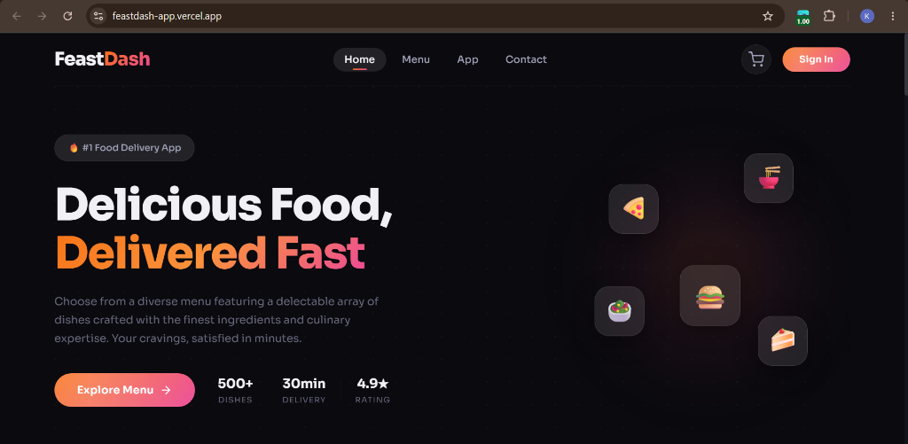
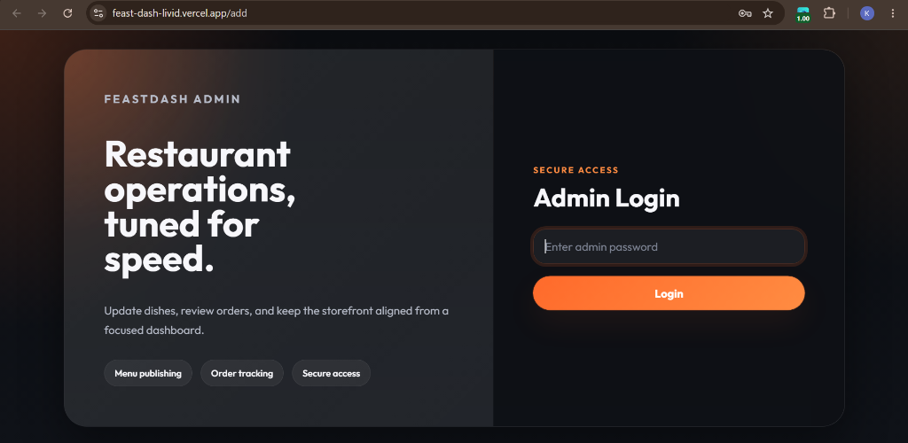
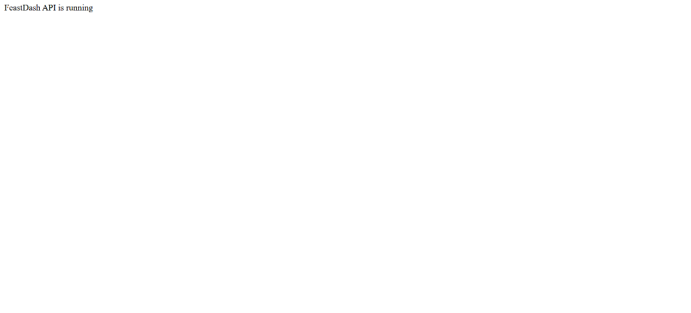
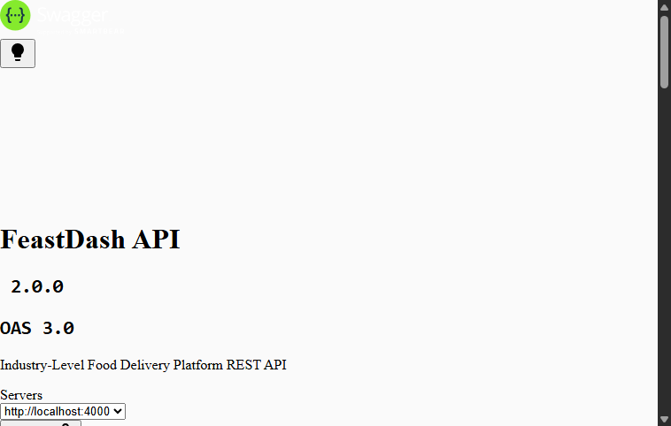

# 🍔 FeastDash — Full-Stack Food Ordering & Delivery Management Platform

[](https://feastdash-backend.vercel.app/api/health)
[](https://feastdash-app.vercel.app)
[](https://feast-dash-livid.vercel.app)
[](https://feastdash-backend.vercel.app/api-docs)

### 🚀 Live Production Links
- 🌐 **Customer Storefront:** [https://feastdash-app.vercel.app/](https://feastdash-app.vercel.app/)
- 🛠️ **Admin Management Dashboard:** [https://feast-dash-livid.vercel.app/](https://feast-dash-livid.vercel.app/) *(Default Admin Password: `FeastDashAdmin2026!`)*
- 🔌 **Backend REST API:** [https://feastdash-backend.vercel.app/](https://feastdash-backend.vercel.app/)
- 📖 **Interactive Swagger / OpenAPI Docs:** [https://feastdash-backend.vercel.app/api-docs](https://feastdash-backend.vercel.app/api-docs)
- 🩺 **Real-time Health Check:** [https://feastdash-backend.vercel.app/api/health](https://feastdash-backend.vercel.app/api/health)

A high-performance, industry-ready food delivery platform built with the **MERN** stack (MongoDB Atlas, Express 5, React 19, Node.js 24). FeastDash features a customer ordering application with live search and order progress tracking, a restaurant admin management dashboard with inventory control and payment visibility, and a secured serverless REST API backend on Vercel with Stripe checkout, cryptographic webhooks, JWT authentication, and Cloudinary cloud image hosting.

---

## 📸 Application Previews

### Customer Storefront & Catalog


### Restaurant Admin Management Dashboard


### Live Backend REST API Status


### Swagger / OpenAPI 3.0 Interactive Documentation


---

## 📐 Architecture

```
FeastDash/
├── frontend/               # Customer-facing React 19 SPA (Vite 7)
│   ├── src/
│   │   ├── Components/     # Navbar, FoodDisplay (live search), LoginPopup, etc.
│   │   ├── Context/        # StoreContext (state & cart synchronization)
│   │   └── Pages/          # Home, Cart, PlaceOrder, Verify, MyOrders
│   └── vercel.json         # Vercel SPA routing rewrite
├── admin/                  # Restaurant Admin React 19 SPA (Vite 7)
│   ├── src/
│   │   ├── components/     # Admin Navbar, Sidebar
│   │   └── pages/          # Add (dish upload), List (inventory), Orders (pipeline)
│   └── vercel.json         # Vercel SPA routing rewrite
├── backend/                # Express 5 REST API (Vercel Serverless Function)
│   ├── config/             # MongoDB Atlas connection & Cloudinary v2 setup
│   ├── controllers/        # Order, Food, Cart, User, Admin handlers
│   ├── middlewares/        # Standard Bearer auth & Admin auth guards
│   ├── models/             # Schema-first models (User, Food, Order)
│   ├── routes/             # REST endpoints & OpenAPI / Swagger docs
│   ├── test/               # Automated integration test suite (node:test)
│   ├── vercel.json         # @vercel/node serverless function configuration
│   └── server.js           # Server entrypoint, CORS, webhook stream, health check
├── docs/screenshots/       # Production screenshots for README
└── README.md
```

---

## ⚡ Engineering Highlights & Security Upgrades

- 🛡️ **Server-Side Price Integrity**: All order totals, item prices, and delivery charges are computed strictly using trusted database records from `foodModel`. Client-tampered prices in HTTP payloads are completely ignored.
- 💳 **Cryptographic Stripe Webhooks**: Secure `POST /api/order/webhook` endpoint with HMAC SHA-256 signature verification (`stripe.webhooks.constructEvent`). Customer carts are preserved until payments are confirmed.
- 🔒 **Role-Based Admin Protection**: Endpoints for adding, editing, and deleting menu dishes (`/api/food/add`, `/api/food/:id`) are strictly protected with JWT admin authorization middleware.
- ☁️ **Cloudinary Media Pipeline**: Custom stream upload buffering directly into `mern_stack_project_storage/FeastDash`, with tracking of `cloudinaryPublicId` for clean cloud asset deletion.
- 🔍 **Interactive Live Search**: Instant client-side search across dishes, ingredients, and categories on the customer storefront.
- 📊 **Order Pipeline Stepper**: Real-time visual tracking (`Confirmed` ➔ `Preparing` ➔ `Out for Delivery` ➔ `Delivered`) on customer order history.
- 💼 **Admin Payment Badging**: Clear **✓ PAID** and **⏳ UNPAID** status badges, order timestamps, and filter tabs on the admin dashboard.
- 🩺 **Health Check Diagnostics**: `GET /api/health` providing real-time database connection status and server uptime metrics.
- 🧪 **Automated API Test Suite**: Zero-dependency automated integration test suite (`backend/test/api.test.js`) verifying registration, login, auth guards, catalog retrieval, and price calculation.
- 🌐 **Serverless Cold-Start Resilience**: Cached Mongoose connection pooling and auto-reconnect middleware engineered specifically for Vercel serverless execution.
- ⚡ **Universal CORS & Preflight**: Edge trailing-slash normalization and instant `HTTP 204` preflight termination for clean cross-origin requests.

---

## 🛠️ Technology Stack

| Layer | Technologies |
| :--- | :--- |
| **Customer Frontend** | React 19, React Router 7, Vite 7, Axios, CSS Modules |
| **Admin Frontend** | React 19, React Router 7, Vite 7, Axios, react-toastify |
| **Backend API** | Node.js 24+, Express 5, Mongoose 8, JWT, bcryptjs |
| **Database** | MongoDB Atlas Cloud Cluster |
| **Payments** | Stripe Checkout (Test & Live modes) & Webhooks |
| **Media Hosting** | Cloudinary v2 SDK with in-memory streaming |
| **API Documentation**| Swagger UI (`swagger-ui-express`, `swagger-jsdoc`) |
| **Testing** | Node.js Test Runner (`node:test`, `node:assert`) |
| **Deployment** | Vercel Serverless (Backend API, Customer Storefront & Admin Dashboard) |

---

## 🔑 Environment Variables

### Backend (`backend/.env`)

```env
PORT=4000
MONGODB_URI=mongodb+srv://<user>:<password>@cluster0.mongodb.net/feastdash?retryWrites=true&w=majority
JWT_SECRET=your_long_random_jwt_secret
ADMIN_SECRET_KEY=your_long_random_admin_secret
ADMIN_PASSWORD=your_admin_login_password
STRIPE_SECRET_KEY=sk_test_your_stripe_secret
STRIPE_WEBHOOK_SECRET=whsec_your_stripe_webhook_secret
FRONTEND_URL=https://feastdash-app.vercel.app
ADMIN_URL=https://feast-dash-livid.vercel.app
MAX_UPLOAD_SIZE_BYTES=2097152
CLOUDINARY_CLOUD_NAME=your_cloud_name
CLOUDINARY_API_KEY=your_api_key
CLOUDINARY_API_SECRET=your_api_secret
CLOUDINARY_FOLDER=mern_stack_project_storage/FeastDash
```

### Customer Frontend (`frontend/.env`) & Admin (`admin/.env`)

```env
VITE_API_URL=https://feastdash-backend.vercel.app
```

---

## 🧪 Running Automated Tests

Run the backend integration test suite:

```bash
cd backend
npm test
```

Expected output:
```
▶ FeastDash API Automated Verification Suite
  ✔ Health check endpoint returns status 200 and connected DB
  ✔ User registration succeeds and returns valid JWT token
  ✔ User login succeeds with correct credentials
  ✔ Authenticated user profile retrieval works via Bearer header
  ✔ Unauthenticated menu addition is strictly rejected with HTTP 401
  ✔ Server-side price verification and order creation
  ✔ Catalog listing returns dishes array
✔ FeastDash API Automated Verification Suite (7 passed, 0 failed)
```

---

## 🚀 Local Development Setup

### 1. Clone & Configure

```bash
git clone https://github.com/karthikeyantoff/FeastDash.git
cd FeastDash
```

### 2. Install Dependencies

```bash
cd backend && npm install
cd ../frontend && npm install
cd ../admin && npm install
```

### 3. Start Development Servers

Open three terminals:

```bash
# Terminal 1 - Backend API (http://localhost:4000)
cd backend && npm run dev

# Terminal 2 - Customer App (http://localhost:5173)
cd frontend && npm run dev

# Terminal 3 - Admin Dashboard (http://localhost:5174)
cd admin && npm run dev
```

---

## 🌐 Production Deployment on Vercel

All three applications are continuously deployed on **Vercel** via GitHub integration:

### 1. Backend REST API (`backend/`)
- **Vercel Root Directory:** `backend`
- **Builder:** `@vercel/node` configured in [`backend/vercel.json`](backend/vercel.json)
- **Production URL:** [https://feastdash-backend.vercel.app/](https://feastdash-backend.vercel.app/)
- **Environment Variables:** `MONGODB_URI`, `JWT_SECRET`, `ADMIN_SECRET_KEY`, `ADMIN_PASSWORD`, `STRIPE_SECRET_KEY`, `STRIPE_WEBHOOK_SECRET`, `CLOUDINARY_CLOUD_NAME`, `CLOUDINARY_API_KEY`, `CLOUDINARY_API_SECRET`, `CLOUDINARY_FOLDER`, `FRONTEND_URL`, `ADMIN_URL`.

### 2. Customer Frontend (`frontend/`)
- **Vercel Root Directory:** `frontend`
- **Framework Preset:** `Vite`
- **Production URL:** [https://feastdash-app.vercel.app/](https://feastdash-app.vercel.app/)
- **Environment Variable:** `VITE_API_URL = https://feastdash-backend.vercel.app`

### 3. Admin Management Dashboard (`admin/`)
- **Vercel Root Directory:** `admin`
- **Framework Preset:** `Vite`
- **Production URL:** [https://feast-dash-livid.vercel.app/](https://feast-dash-livid.vercel.app/)
- **Environment Variable:** `VITE_API_URL = https://feastdash-backend.vercel.app`

---

## 👤 Author & Attribution

- **Forward Deployed Engineer:** [Karthikeyan](https://github.com/karthikeyantoff) (`karthikeyantoff`)
- **Original Starter Codebase Attribution:** Based on an open-source project by Maulik Gupta, customized, security-hardened, and extended into FeastDash.
- **License:** ISC
